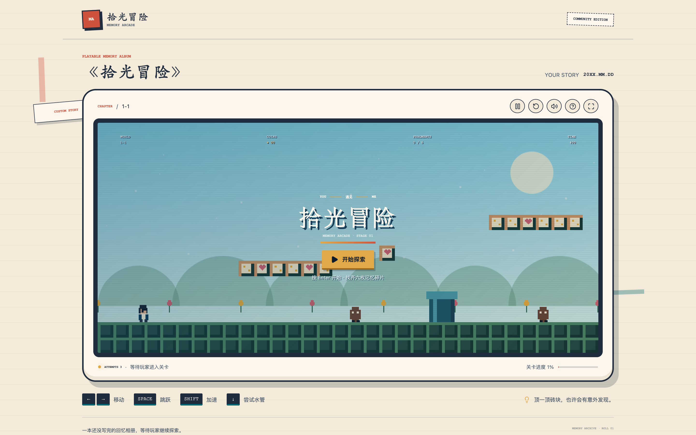

# Memory Arcade / 拾光冒险

一个可自定义的 React 像素平台闯关模板。玩家在关卡里寻找六枚记忆碎片，完成后依次看到故事终章、最终问题和可选的隐藏奖励。

仓库默认只包含虚构示例文案和原创 SVG 占位图，不包含真实姓名、私人照片、纪念日期、个人域名或原项目的 Git 历史。

## 在线体验

[在 GitHub Pages 上开始游戏](https://juliantanx.github.io/memory-arcade/)



## 功能

- 键盘与触屏均可完成的平台闯关
- 六段可配置的图文回忆，随机分布在可到达区域
- 随机隐藏房、代金券和奖励解锁流程
- Canvas 程序化像素画，不依赖商业游戏素材
- 响应式布局、全屏、静音和减少动态效果支持
- PWA 离线缓存
- Vitest 游戏逻辑测试与 GitHub Actions CI

## 故事设定

《拾光冒险》把一段共同经历包装成一场可以亲手完成的像素冒险。玩家从故事的起点出发，在关卡中寻找六枚散落的“记忆碎片”。每次顶出碎片，游戏会暂停并翻开一页图文回忆；当六页回忆全部找齐并抵达终点后，它们会被拼成一封完整的信，引出最后的问题和新的篇章。

仓库中的内容只是便于演示结构的虚构占位故事：

| 章节 | 主题 | 在完整故事中的作用 |
| --- | --- | --- |
| 01 / 故事开始 | 初次相遇或共同出发 | 交代两位玩家为什么踏上这段旅程 |
| 02 / 闪光小事 | 日常里的细节 | 用具体的小事建立真实感和亲密感 |
| 03 / 蓝色时刻 | 旅行、兴趣或成长 | 展开一段值得慢慢回看的共同经历 |
| 04 / 计划之外 | 意外与转折 | 记录没有按计划发生、却变得珍贵的时刻 |
| 05 / 普通日子 | 陪伴与日常 | 表达普通生活本身也值得被收藏 |
| 06 / 下一关 | 回望与未来 | 收束过去六章，并把故事带向终章 |

终章先展示写给玩家的信，再提出一个可自定义的问题。默认示例是“愿意和我一起开启下一关吗？”，玩家确认后进入庆祝画面。这里的“下一关”可以代表一次旅行、纪念日邀请、生日惊喜、告白、求婚，或任何属于你们的新计划。

## 完整游戏流程

```text
开始探索
  ↓
在主关卡移动、跳跃、顶砖和躲避敌人
  ├─ 顶出 6 枚记忆碎片 → 逐页阅读六段回忆
  ├─ 找到隐藏代金券       → 在庆祝画面揭晓特别体验
  └─ 找到秘密水管与神秘道具 → 终章后获得钥匙并解锁隐藏礼物
  ↓
抵达终点并清点本局收集结果
  ├─ 记忆不足 6 枚 → 重新探索，新一局重新随机藏品
  └─ 记忆集齐      → 拼接碎片 → 阅读终章 → 回答最终问题
                                      ↓
                          庆祝画面与已找到的隐藏奖励
```

### 主线规则

1. 六段回忆按章节顺序放在关卡的六个连续区段中，但每段回忆具体藏在哪块砖里，会在每次完整重开时重新选择。
2. 顶到藏有回忆的砖块后，会打开对应的图文页面。关闭页面即可从原处继续，不会丢失本局进度。
3. 玩家可以在没有集齐回忆时抵达终点，但只有六枚碎片全部找到，才能拼接故事并进入终章。
4. 终章依次经历“信件”“最终问题”“庆祝”三个阶段；主线通关不要求找到隐藏奖励。

### 隐藏支线

- **隐藏代金券：** 随机藏在一块普通可顶砖中。找到后先收入背包，在最终庆祝画面才会翻面揭晓内容。
- **秘密房间：** 六根水管中随机只有一根可以进入。站在管口按下方向键可进入地下房间。
- **神秘道具：** 地下房间的金币中随机藏有一件神秘道具。若成功带到终章，它会变成钥匙，用来解锁隐藏礼物。
- 两件隐藏奖励互不影响，也不阻止主线结局；遗漏后可以重新探索，但下一局的位置会再次随机。

### 失败、重试与重开

- 角色变大时受到伤害会先恢复为小角色；小角色再次受伤、掉进深坑或时间耗尽时会失去一次机会。
- 仍有机会时，角色会从最近的安全落脚点继续。本局已经看过的回忆和找到的奖励都会保留。
- 默认可失败 3 次，可在帮助面板中设置为 1–99 次，并在下一次完整重开时生效。
- 机会耗尽或主动重新开始会创建一局全新游戏：分数与收集进度清零，碎片、代金券、秘密水管和神秘道具重新随机。
- 游戏不把收集进度写入本地存储；刷新页面也会从新的一局开始。

## 本地运行

需要 Node.js 20 或更高版本。

```bash
npm install
npm run dev
```

验证发布版本：

```bash
npm test
npm run build
npm run preview
```

## 自定义

大多数改动只需要两步：

1. 编辑 [`src/content/story.js`](src/content/story.js)，替换站点信息、六段回忆、终章问题和奖励文案。
2. 替换 [`public/content/`](public/content/) 下的 SVG 占位图；也可以改用 JPG、PNG 或 WebP，并同步修改配置中的文件名和无障碍描述。

`src/content/story.js` 中三个配置区分别负责：

- `PROJECT`：网站标题、游戏名称、日期标识和页脚文案。
- `MEMORIES`：六个章节的标题、正文、日期、图片、替代文本和配色。
- `FINALE` / `REWARDS`：终章信件、最终问题、代金券及隐藏礼物。

请保留六条 `MEMORIES`，数组顺序就是故事阅读顺序。每条 `id` 必须唯一，`accent` 可使用 `rose`、`gold`、`ocean` 或 `green`。图片尺寸不必完全相同，页面会完整显示图片并保留其原始比例。

更完整的发布前检查见 [`docs/RELEASING.md`](docs/RELEASING.md)。

## 项目结构

```text
src/
├── content/             # 唯一的故事与素材配置入口
├── components/          # React 界面与终章流程
├── game/                # 物理、原创关卡、音频与 Canvas 渲染
└── hooks/               # React 与游戏控制器的桥接
public/content/          # 可安全公开的占位素材
.github/workflows/       # 自动测试与构建
```

## 部署

`npm run build` 会生成 `dist/`。可部署到任意静态托管服务。若发布在子路径下，例如 GitHub Pages，请设置 `BASE_PATH`：

```bash
BASE_PATH=/your-repository/ npm run build
```

应用和 Service Worker 均使用该公共路径。

## 隐私与素材权利

把真实内容加入公开仓库前，请确认照片中所有人物同意公开，并清理 EXIF 定位信息。不要提交私钥、访问令牌、聊天记录、内部链接或未获授权的字体、音乐、品牌图片和商业游戏素材。MIT 许可证只覆盖本仓库中的代码与原创占位素材，不会自动授予你上传内容的权利。

## 参与贡献

见 [`CONTRIBUTING.md`](CONTRIBUTING.md)。安全问题请按 [`SECURITY.md`](SECURITY.md) 处理。

社区交流：[Linux DO](https://linux.do/)

## License

[MIT](LICENSE)
